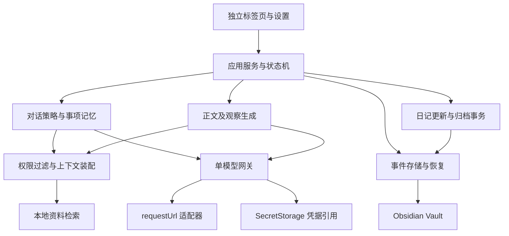

# 技术架构与数据协议

这是首版工程方案，不是现有实现。M0 验证后可调整内部结构，但不得削弱正文忠实、人工编辑优先、跳过记忆和数据恢复要求。

## 技术方向

采用 TypeScript、Obsidian 官方 API 与 esbuild。核心业务写成不依赖 Obsidian 的纯模块；Obsidian 文件、视图、设置与请求通过适配层接入。首版优先原生 DOM，减少移动端依赖体积。

移动端不能依赖 Node.js 或 Electron API。运行时文件访问使用 Vault，避免引入 `fs`、`path`、原生数据库和仅桌面可用的依赖；开发构建工具可使用 Node。依据：[官方移动开发说明](https://docs.obsidian.md/Plugins/Getting%20started/Mobile%20development)。

首版建议以 Obsidian 1.11.5 为兼容起点，M0 根据双端 API、依赖类型和实际运行结果冻结 `minAppVersion`；不能使用最新类型包里的新方法却仍声称支持旧版。`isDesktopOnly` 目标为 false，Android 的真实状态单独报告。

## 模块与依赖



| 模块 | 责任 | 不得承担的责任 |
| --- | --- | --- |
| UI | 页面切换、输入、编辑、状态和必要冲突处理 | 直接拼提示词或盲目写正式笔记 |
| SessionService | 日期、请求状态、消息与草稿生命周期 | 将缓存当作唯一事实来源 |
| ConversationPolicy | 问题去重、入口覆盖、事项状态 | 让模型自行解除抑制 |
| ContextBuilder | 分离当天事实、正文基线和历史证据 | 整库发送、把历史当当天 |
| ModelGateway | 单一配置、任务请求、格式解析和错误分类 | 自动切到另一服务或模型 |
| DiaryService | 两种风格、追加、重新整合、来源映射 | 用旧问答覆盖用户编辑 |
| ArchiveService | 版本比较、备份、幂等写入及恢复 | 把多个文件写入声称为天然原子操作 |
| MemoryService | 允许资料的检索、后续事项与来源链接 | 以 AI 观察循环证明 AI 观察 |

建议代码目录：

```text
src/
  main.ts
  ui/DiaryView.ts
  ui/SettingsTab.ts
  domain/{session,events,threads,diary,schemas}.ts
  application/{conversation,generation,archive,recovery}.ts
  ai/{gateway,chat-completions,context,validation}.ts
  memory/{permissions,retrieval,evidence}.ts
  storage/{event-store,projections,migrations}.ts
  adapters/{obsidian-vault,secrets,http}.ts
  prompts/
tests/{unit,integration,e2e,fixtures,evals}/
```

## 页面与请求状态

业务页面：`setup → entry → conversation ↔ preview → archived`。补记从 archived 进入 conversation，生成时携带 append 或 reintegrate 模式。错误和冲突是原页面上的可恢复状态，不能把用户送回空白入口。

请求状态与页面分开：`idle / pending / failed / abandoned`。一场会话同时只采用一项会改变内容的生成请求；切换日期、撤回资料授权、改变端点、停止等待或开始新一版生成均使旧请求失效。

每项请求携带 requestId、sessionId、contextRevision、permissionRevision 和 generationRevision。响应必须与当前版本匹配，才可写入消息、草稿或记忆。超时不表示服务端已停止处理，迟到结果不得再弹回界面或污染新稿。

输入草稿与已发送消息分开。输入可短延迟保存，并在发送、生成、页面切换、关闭视图等边界立即刷写；不能只依赖移动端后台退出回调。已发送消息必须在网络请求前完成本地存储。

## 单模型配置与网络

配置示意：

```ts
interface ModelProfile {
  protocol: 'chat-completions';
  baseUrl: string;
  modelId: string;
  credentialRef: string;
}
```

首版一个 profile。参考 DSH 的配置分层与失败保留输入，不引入其多服务运行时。

- Base URL 指到 API 根，适配器明确拼接 chat/completions；测试覆盖尾斜杠、已有 `/v1`、代理前缀和重复路径，避免擅自增删用户代理路径。
- 支持手工模型名称，连接测试使用不含日记的最小文本请求；模型列表发现不作为完成条件。
- 基线请求为文本 messages、model 和非流式返回；不要求上游支持工具调用、强制 JSON 模式、特定推理参数或某个厂商 SDK。
- 结构化内容先通过提示词约束并在本地校验；特殊兼容参数只有经验证后才增加。
- 连接成功仅证明该地址、密钥、模型在该设备上能完成测试；不代表所有模型能力已验证。

基线网络适配使用 Obsidian `requestUrl`，其官方说明为无 CORS 限制的 HTTP/HTTPS 请求。当前公开参数没有通用 AbortSignal 字段，因此首版只承诺应用层停止采用结果，不承诺物理中止连接或流式接收。依据：[requestUrl](https://docs.obsidian.md/Reference/TypeScript%20API/requestUrl)、[官方类型定义](https://raw.githubusercontent.com/obsidianmd/obsidian-api/master/obsidian.d.ts)。

错误区分字段缺失、凭据缺失、鉴权失败、限流、服务错误、连接错误、上下文超限及输出格式错误。自动格式修复最多一次；失败后不无限重试和累积费用。日志只写错误码与请求 ID，不写 Authorization、原始日记正文或服务返回的敏感正文。

## 凭据、普通设置与本机状态

普通设置保存 profile、入口定义、风格、目录与允许资料范围。凭据通过 SecretStorage 使用引用，名称采用插件前缀和随机仓库命名空间，避免不同仓库碰撞。密钥不写入 `data.json`、Markdown、事件记录、日志或打包文件。

官方 SecretStorage 指南支持在设置里保存名称、请求时取值；桌面 1.11.5 发布说明记录了静态存储加密改进。移动端隔离与持久化行为仍须实测，不从桌面实现推断。依据：[凭据指南](https://docs.obsidian.md/plugins/guides/secret-storage)、[桌面发布说明](https://obsidian.md/changelog/2026-01-20-desktop-v1.11.5/)。

默认每台设备各配置凭据，普通参数可跟随仓库配置同步。缺少 API 或取不到值时给出明确升级/配置路径，不静默降级为明文密钥文件。设备 ID、检索缓存和临时 UI 状态保持本机化；完整可恢复的业务状态不能仅放本机缓存。

## 文件布局与事实来源

目录名称可配置，以下是建议默认值。用于 Sync 的业务目录不以点开头。

```text
日记/2026/10/2026-10-12.md                 # 正式日记，每天一篇
原始问答/2026/10/2026-10-12.md             # 可读对话汇总，与日记互链
原始问答/_数据/2026/10/2026-10-12/
  <deviceId>-<writerInstanceId>.md          # 本设备本写入实例的追加事件段
原始问答/_版本/2026/10/2026-10-12/
  <transactionId>.md                       # 替换正式日记前的恢复副本
```

正式日记以最新文件内容为准，人工修改具有最高优先级。事件段保存用户消息、模型已展示内容、输入草稿、预览稿版本、事项抑制和归档信息；可读问答汇总是这些消息的投影。缓存可重建，但用户修改、草稿和抑制状态不可依赖模型重新推断。

采用分设备写入段，是为了减少两个设备同时修改一个状态文件的风险。**不是实现自有 Sync 服务或通用 CRDT**。Markdown 内采用带版本与完整性信息的事件块，避免普通 JSON 文件被另一设备最后写入覆盖。M0 验证解析与 Sync 行为，必要时简化格式但不能退回单一共享状态 JSON。

Obsidian 官方说明：Markdown 冲突可自动合并或生成冲突副本；其他文件常按最后修改获胜；隐藏目录通常不参与 Sync。单纯把 JSON 改成 `.md` 后缀仍无法解决结构冲突。依据：[Sync 设置](https://obsidian.md/help/sync/settings)、[冲突机制](https://obsidian.md/help/sync/troubleshoot)。

## 事件契约

```ts
interface DiaryEvent {
  schemaVersion: 1;
  eventId: string;
  sessionKey: string;       // 稳定的记录日期，例如 day:2026-10-12
  writerId: string;
  sequence: number;
  parentEventIds: string[];
  createdAt: string;        // UTC 时间戳；记录日期单独保存
  type: string;
  payload: unknown;        // 按 type 做严格 schema 验证
}
```

事件类型至少包括：session-started、user-message、assistant-message、input-draft-saved、draft-generated、draft-edited、thread-suppressed、thread-reopened-by-user、archive-prepared、archive-completed。入口配置有稳定 ID，改名不打断历史。

归档和草稿还需保存：正文基线哈希、草稿版本、已消费用户消息 ID 集合、证据 ID、事务 ID。不能只用时间戳确定哪些回答算“新增”，也不能只按不同设备的时钟排序。

归并规则：

1. 按 eventId 去重，按因果父节点和本段序号还原；时间只用于展示与无依赖事件的稳定排序。
2. 单一已完成事件不可原地改内容；用户纠正通过新事件表达。
3. 不完整块保留原文件，提示恢复，不直接丢弃整段或猜出缺失用户文字。
4. 父节点未到达时保留待处理状态，不强行采用截断摘要；后续文件到达后重新投影。
5. 并发草稿分支保留双方，不能把两篇文章按字串拼接成最终稿。
6. 并发抑制与重开冲突时，只有明确发生在抑制之后的用户重开才能解除；未知因果默认继续抑制。

事件记录采用追加队列，UI 显示本机保存状态只在写入完成后成立。不要声称一次本机写入成功就已同步到另一设备；没有可靠公开状态接口时不伪造“云端已同步”。

## 人工编辑与重新整合

生成前读取最新正式文件或当前草稿，记录内容哈希和已消费消息集合。重新整合的来源集只包含该正文及新增用户素材；旧问答、旧摘要和历史 AI 观察不得作为正文事实补充源。

保存时再次读取并比较基线。使用 `Vault.process` 的同步检查回调避免本地读写之间的意外覆盖；异步模型调用放在回调外。此保证不替代跨设备冲突处理。依据：[Vault 修改指南](https://docs.obsidian.md/Plugins/Vault)。

正文、观察、互链和元数据可按明确区域管理；保留未知 frontmatter 与用户额外内容。区域标记被删除或结构不明时保留完整当前文件，不进行猜测式覆盖。

如果文件在生成后被修改，保留当前文件和待保存稿，在同标签要求处理实际版本差异。追加模式保证当前正文不变，只附加未消费的新内容；重复点击保存使用同一 transactionId，不重复追加。

## 归档事务与中断恢复

多文件写入没有天然事务。采用幂等步骤：

1. 持久化 archive-prepared，保存目标路径、基线哈希、草稿和消费消息集合。
2. 如将替换现有文件，保存恢复副本。
3. 校验当前正式文件，写入已确认的日记；日记含本次事务标识。
4. 写入可读问答汇总和互链；只投影，不删除底层用户记录。
5. 持久化 archive-completed。

任意一步失败都保留恢复信息。重开后通过事务标识判断已经完成的步骤，只补齐剩余部分；不能因完成事件未写入而重复覆盖或重复追加正文。可读问答若被手动修改，同样先保留当前副本再处理投影冲突。

## 资料检索与权限

- 首版限定 Markdown 文本资料，目录和文件由用户允许；这是工程范围默认值，PDF、图片和全库索引可后续扩展。
- 先在白名单内枚举和检索，不先读全库再过滤；拒绝越出仓库的路径和意外解析到未允许文件的链接。
- 默认排除问答内部数据、版本备份、草稿、历史 AI 观察段和当日日记的历史副本；防止删除内容经检索回流。
- 本地使用标题、实体、关键词和时间相关性检索，中文可用分词或字符片段；无须额外 embedding 服务。
- 给每个片段分配 evidenceId，记录路径、文件哈希、引用范围和日期；发请求前再检查权限。
- 对话上下文与正文上下文分开装配。正文重整合只装配授权的当前正文与新增用户信息，历史仅进入观察任务。
- 长会话可以生成带来源 ID 的摘要，但原始消息保留；权限、抑制和用户否定信息不得被压缩掉。
- 初始上下文预算采用保守上限，按服务实际限制验证；token 估算不可当作精确计费。

## 安全与迁移

笔记是数据，不是系统指令；模型无文件写入工具。渲染使用 Obsidian 提供的 Markdown 能力或安全文本节点，不能把模型原始 HTML 直接注入。

schemaVersion 必须可迁移。迁移前保存副本，失败则停止该数据写入并保留旧格式。未安装插件时，正式日记和问答汇总仍是可读 Markdown。首版不开发自动清理与删除历史数据，避免把保留策略变成不可逆的数据丢失。
