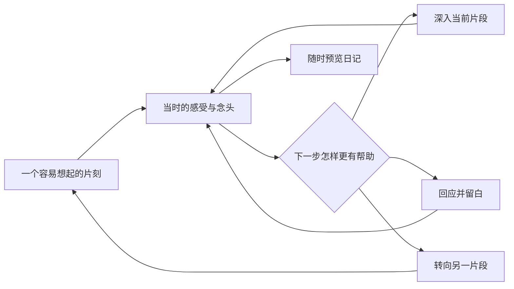

# 体验重构调研与规划

> 此处保留 0.2.0 的研究与历史方案。2026-10-13 用户要求简化框架并沿用 Obsidian 主题，已在 0.2.1 替代问答规则和固定视觉；现行方案见 `11-自然回顾与主题适配.md`。

日期：2026-10-12。建议目标版本：0.2.0，尚未确定发布范围。本文件是待讨论的改版方案，本轮仅调研、阅读代码和编写规划，不修改插件实现、提示词、配置、测试或安装包。

实施更新：用户随后已授权开始修改，当前进入 0.2.0 实现与验证。下文保留规划时的决定和边界，实际产物与验证状态见 [测试报告](测试报告.md) 和 [问答质量评测](10-问答质量评测.md)。

## 1. 本次方向与已有约束

最新用户要求优先：重新设计审美和前端；重新设计问答机制；以情感和思考为主、事实为辅，帮助还原一天。此前“多角度覆盖”的目标相应调整为回到当时的体验、看见一天中的变化，而非补齐工作、人际等分类。

产品目标建议写成：**帮我回到那一天，想起当时的感受、念头和变化，再替我写下来。**

继续保留已确认要求：主工作区独立标签页；文字输入、Android 优先；用户随时生成；允许只回应、“继续问我”与跳过；跳过具体事项持续生效；正文忠实、AI 推测独立；双风格；预览编辑后保存；当前正文优先；问答互链；单服务单模型；官方 Sync 接续。

下文的配色、布局、问题类型、内部状态、评测门槛和实施顺序是本轮提出的设计选择，尚不代表用户逐项确认。情感优先不授权 AI 编造情绪、动机或人物关系。

## 2. 对当前版本的诊断

以下区分源码观察与设计判断，不把合成测试页面当作实际宿主体验。

| 现状 | 源码依据 | 对体验的影响判断 |
| --- | --- | --- |
| 短回应和一个问题是主要输出结构 | `src/prompts/index.ts`、`src/application/diary.ts` 将 text/question 拼接 | 虽然已支持 acknowledge，但缺少“何时值得追问”的决策，容易形成总结一句、再问一句的节奏 |
| 覆盖状态按用户消息出现过的 topicId 计算 | `coveredTopics` | 聊到工作不等于还原了工作时的感受，更不能代表一天已被看见 |
| 最近 40 条对话和已问问题进入上下文 | `DiaryApp.reply()` | 尚无可靠的全天片段和感受变化结构，较长对话中容易只盯着最近一句 |
| 去重主要比较去掉标点后的问题字符串 | `src/ai/validation.ts` | 改写措辞仍可能重复询问同一信息 |
| 生成文本有来源映射 | `validateWriting()` | 有利于追溯，但不证明问题有价值、日记有本人语气或有足够内在体验 |
| 对话气泡、表单和多个操作同时突出 | `src/ui/screen.ts` | 视觉重心分散，当前问题、用户文字、控制项缺少层级 |
| 对话区另设 54vh/45dvh 高度并滚动 | `styles.css` | 容易产生嵌套滚动、空间割裂，手机键盘出现后尤其需要重做 |
| 预览以大 textarea 为主要内容 | `preview()` | 先看到表单，阅读自己的日记缺少完整文章感 |

现有 85 项自动测试主要保障工程流程。下一轮应把“是否找回更多真实感受和念头、是否愿意继续说、成文是否值得回看”纳入主要验收。

## 3. 调研结果与采用边界

### 3.1 设计资源

已按要求找到并阅读 [gztchan/awesome-design](https://github.com/gztchan/awesome-design)。它汇集配色、字体、图标、原型与风格指南资源，可用作参考入口；本方案从中选择排版和配色资源继续查看，具体视觉方案由本产品的阅读与记录场景决定。

| 已查看的来源 | 可采用的原则 | 在本产品中的提案 |
| --- | --- | --- |
| [Butterick’s Practical Typography](https://practicaltypography.com/summary-of-key-rules.html) | 正文字号、行距、行长与字体共同决定阅读质量 | 先建立中文阅读尺度；不照搬其西文行长、行距或字体购买建议 |
| [Nippon Colors](https://nipponcolors.com/) | 传统色可作为低饱和配色参考 | 用克制的纸白、墨灰和植物绿；下文具体色值为自拟，不是该网站的既有组合 |
| [W3C 文字对比](https://www.w3.org/WAI/WCAG22/Understanding/contrast-minimum.html)、[触控目标增强标准](https://www.w3.org/WAI/WCAG22/Understanding/target-size-enhanced.html) | 文字需要足够对比，触控需要足够面积 | 常规文字对比目标至少 4.5:1，手机操作热区建议 44px；44px 是本方案采用的增强目标，不等同于所有 AA 要求 |

### 3.2 日记回顾与对话研究

| 来源与实际查阅范围 | 支持的观察 | 本项目设计推论 |
| --- | --- | --- |
| [Kahneman 等，Day Reconstruction Method，2004，原论文](https://greatergood.berkeley.edu/images/uploads/Kahneman-DayReconstructionMethod.pdf) | 先恢复具体片段，再回顾情境及体验，是一种回忆组织方式 | 用场景和转换点帮助想起当天；借用片段线索，不要求精确时刻或逐项量表 |
| [Lucas 等，DRM 与 ESM 直接比较，2020 在线／2021 刊发，摘要](https://pubmed.ncbi.nlm.nih.gov/32202810/) | 群体汇总的一致性不能推及一个人各时刻的体验，一些个体内对应较低 | 保留“记不清”“现在回想觉得”，不把回忆图谱当成精确情绪测量 |
| [Diarybot，DIS 2021，作者机构页面摘要](https://www.microsoft.com/en-us/research/publication/i-wrote-as-if-i-were-telling-a-story-to-someone-i-knew-designing-chatbot-interactions-for-expressive-writing-in-mental-health/) | 30 人、4 天研究考察了有无跟进互动的表达式写作体验 | 回应要给继续表达的空间；更多追问并非默认更好。该研究场景和周期有限 |
| [Karaturhan 等，2024，出版方摘要](https://link.springer.com/article/10.1007/s00779-024-01831-7) | 34 人、一周原型研究强调上下文、重复及问句/非问句平衡 | 把回应、提问、等待、转向作为独立决策；未取得付费全文，不据此声称已验证具体算法 |
| [ExploreSelf，CHI 2025，作者公开论文](https://younghokim.net/files/papers/exploreself-chi25.pdf) | 19 人探索性研究报告了用户对可选择、可导航反思过程的重视 | AI 推荐下一方向，用户能跳过、换角度和自由续写；采用轻量选择，不复制完整主题树 |
| [Ullrich 与 Lutgendorf，2002，摘要](https://pubmed.ncbi.nlm.nih.gov/12173682/) | 该特定学生与压力写作研究区分了情绪表达、认知处理等条件 | 设计上同时关注想法与体验，避免只反复追问负面感受；不能推广为本插件具有治疗效果 |

上述资料提供的是设计线索。具体中文措辞、默认节奏和界面效果，仍需在选定模型与完整新版上检验。研究中使用的临床场景、量表、诊疗目的与行为干预不直接移入本产品。

## 4. 新体验：先找回片刻，再展开内在体验

建议流程：从一个容易想起的片刻开始，跟随用户表达深入；当前片段自然收束后，轻轻寻找一天中其他不同的片刻；用户随时生成。



这不是必须逐步完成的访谈程序。用户开口就是情绪、想法或长段叙述时直接接上，不先补问地点、人物和时间。事实只补到能够理解体验、区分片段、忠实成文的程度。

## 5. 前端重绘方向

### 5.1 视觉定位

建议采用“安静的私人手记”：让问题、用户的文字和最后的文章成为视觉中心。使用统一的中文排版、窄阅读列、少量色彩和稳定的操作位置。

| 元素 | 建议规范，属于待验证的设计默认值 |
| --- | --- |
| 浅色 | 背景 `#F7F6F2`，正文 `#282C29`，次级文字 `#626B64`，强调 `#496451`，分隔 `#DDDFD7` |
| 深色 | 背景 `#1D211F`，正文 `#E7EBE6`，次级文字 `#A4AFA5`，强调 `#A3B8A7`；按钮文字另配深色，不直接沿用浅色方案 |
| 主题 | 支持随 Obsidian 明暗主题；上述为默认视觉方向，落地前验证主题变量和对比 |
| 字体 | 正文优先宿主文字字体，界面使用宿主界面字体；中文系统字体回退，不为首版加载远程字体 |
| 字号 | 页标题 28px／手机 24px；当前问题 20px／手机 18px；正文与输入 16–17px，辅助文字 13–14px |
| 阅读 | 中文行距约 1.75–1.9；桌面阅读列约 680px，手机左右留白 16–20px |
| 间距 | 4、8、12、20、32px 为基础；同类内容紧凑、片段之间留出明确间隔 |
| 形状 | 少量 8–12px 圆角与细分隔；主要依靠排版组织内容 |
| 状态 | 保存成功为安静的小状态；错误只在需要行动时展开；请求等待可停止，草稿持续可见 |
| 动效 | 短淡入和状态转换；尊重减少动态偏好，不用逐字打印增加等待 |

具体色值和字号须在 Windows、Android、明暗主题与字体放大条件下检查，不能只凭一张截图定稿。

### 5.2 开始页

主标题是“今天，先从一个片刻说起”。下方一个可以直接输入的区域，允许自由表达。辅助入口以轻选项呈现，例如“有个片刻还留着”“今天有些混杂”“平淡地过了一天”；这些是帮助开口的方向，不把选项当作用户已陈述的心情。

原来的自定义工作、人际、运动等入口保留在“从某个方面聊”中，仍可新增、改名和关闭。未完成会话优先提供“接着上次聊”。不要求先选择情绪评分或填全天时间表。

### 5.3 对话页

- 页首只保留日期、随时可点的“生成日记”和设置入口。
- 当前有效问题用较大的文字单独呈现；回应可以短，也可以省略。用户回答以清楚的段落呈现，减少每条消息的装饰负担。
- 历史回答仍可回看，不因为突出当前问题而隐藏原始上下文。
- 底部输入区固定在可用空间内；“发送”为主要填色按钮，“继续问我”为轻操作，“换个方向”收纳更多控制。
- “先不聊这件事”仍持久抑制具体事项；“换个问法”只在用户主动需要时使用，不自动生成同义重复问题。
- 可查看“今天聊到的片刻”，默认收起。仅展示用户有依据的短标签，不画 AI 猜测的情绪曲线，不显示完成率。
- 桌面和手机都采用清楚的单一主滚动区域；处理键盘、视口变化、输入法与滚动位置。

概念结构示意，仅用于规划，尚非视觉稿或实现：

```text
10 月 12 日                              生成日记  ···

下午，改方案的那一段

你说“这一天全耗在上面了”。
当时你最希望有时间做什么？

我本来想继续做那个小工具，结果一直没碰。

……此前的对话仍可回看……

┌──────────────────────────────────────────────┐
│ 想到什么就接着说……                           │
│                                              │
└──────────────────────────────────────────────┘
继续问我                 换个方向                发送
```

此处问题文案来自下方合成对话的前序材料；真实界面不能在尚无对应材料时显示这句话。

### 5.4 日记预览与设置

预览默认是完整文章的阅读状态：日期、标题、舒适正文、折叠的 AI 观察，以及清楚的保存操作。点击“编辑正文”切入同页编辑，保留光标与修改；“返回对话”保持已有进度。两种写作风格继续可用，观察依旧与正文分开。

设置页按“模型连接、写作、参考资料、归档”分组；维持 0.1.1 的模型自动保存与凭据独立。连接配置状态、是否能调用、生成过程分开表达，避免把“保存成功”写成“服务已可用”。

## 6. 重新设计问答机制

### 6.1 内部维护全天体验线索

建议引入 DayMap，作为可追溯的内部状态，而非让用户填写的新表格。

| 维度 | 记录什么 | 约束 |
| --- | --- | --- |
| 片段 | 大致处于哪段时间、用户自己的片段称呼、必要情境 | 允许时间未知；不填造地点或顺序 |
| 感受 | 用户实际用过的词、混合感受、是否后来变化 | “没什么感受”也是有效回答 |
| 念头 | 当时脑子里的话、现在回头的理解 | 分清当时与现在，不替用户补思想 |
| 在意之处 | 用户自己表达的期待、愿望、遗憾或珍惜 | AI 的可能理解单独标注，不升级为事实 |
| 转换 | 从一个片段到另一个片段时的体验变化 | 只记录有来源的变化，不默认“后来好起来了” |
| 边界 | 不想展开、已聊够、未知、用户纠正 | 不把拒绝或未知列为必须补齐的缺口 |
| 来源 | 消息、用户当前编辑、允许的资料片段 | 每条线索有来源，旧观察不循环进入事实 |

现有 topicId 可以继续组织入口，但不能单独代表回顾覆盖。长对话保留全天线索与最近对话，避免最近 40 条成为理解这一天的全部依据。

### 6.2 每轮先决定动作

建议把一轮分为三个逻辑职责：更新已知线索、选择下一动作、写成自然话。首版可以在同一个模型请求里返回简短决策字段和对外文本；同一服务、同一模型，不增加多 Agent 或多模型依赖。

动作建议包括：唤起片段、询问感受、询问念头、澄清期待、连接变化、回应留白、换片段、关心获准历史事项、准备成文。根据实际材料选其中一个，不按固定顺序全部问完。

模型只返回简短目的标签、针对的来源 ID、所选角度和对外文本，用于检查是否重复或越界；不要求输出或保存冗长的内部推理。

### 6.3 选择问题的标准

每个候选问题要能说明：**为什么在这里问，以及它可能帮助留下什么尚未表达的体验。**

检查要点：

1. 对应一个用户给出的具体片段或表述；开场确无素材时才用较宽的提示。
2. 用户尚未回答该信息；语义去重同时比较目标片段、目标维度与已知答案。
3. 优先寻找感受、念头、期待或变化；缺失事实仅在影响理解时询问。
4. 不在问题里预设未被表达的情绪、动机或结论。
5. 回答负担合理，至多一个主要问题，允许很短地答或表示不知道。
6. 有机会丰富日记，而不是仅仅延续聊天。

这些是设计评价标准，尚未证明能被一个评分函数可靠衡量。落地时可生成少量候选，先用规则排除越界、重复和无来源问题，再由同一模型依据具体上下文选择；不能只凭模型自评分宣称有效。

### 6.4 可用的询问角度

下表提供条件与示例，不是固定题库。例句需要相应材料支持。

| 角度 | 适用情形 | 可采用的问法 |
| --- | --- | --- |
| 回到片刻 | 用户只给一天的模糊结论 | “今天哪个片刻，让这种感觉最容易想起来？” |
| 感受分辨 | 用户已说“烦”，但含义仍含混 | “你说的这份‘烦’，当时具体是什么滋味？” |
| 当时念头 | 已有事件和感受，却没有内心的话 | “那一刻，你心里最想说的一句话是什么？” |
| 期待 | 用户已表达落差或“本来想……” | “你原本希望这一段时间是怎样的？” |
| 体验变化 | 已知两个先后片段 | “到了晚上，这种感觉有什么变化？” |
| 表达中的两面 | 用户已明确给出相反体验 | “你说既松了口气又有点失落，哪一面现在更明显？” |
| 轻微而可记的细节 | 用户主动提及一个小片刻 | “那个片刻，最让你记住的是什么？” |
| 横向回顾 | 当前片段自然收束，需要拓宽一天 | “除了刚聊的这一段，今天还有没有感觉很不一样的片刻？” |

避免连续套用“你说……那你……”的句式；引用用户原话有明确作用时才使用。也避免为了显得深刻而追问童年、人格和隐藏原因。

### 6.5 回应与停止深入

回应应帮助用户接着表达，或给已经足够的表达留下空间。可以直接提出有依据的问题，可以只回应，也可以安静等待，不强制每轮复述。

用户长段表达、明确疲惫或强烈情绪时优先放慢；已说清楚或同一角度没有新材料时自然收束。连续两轮没有新材料可作为“考虑换方向”的软信号，不成为强制结束规则。用户愿意深入且有新材料时继续；不知道、平淡和不想说都有效。

“继续问我”调用下一步选择，寻找不同且有用的角度。跳过的事项不因新的 DayMap 或换一种说法而恢复；只有用户主动重提才可重开。历史关心依旧受授权和来源约束，不能打断用户正在展开的当日体验。

## 7. 合成对话示例

以下为设计示例，不是用户真实记录，也不是模型实测结果。每一步应随真实回答变化，不能把整段当成固定剧本。

> 用户：下午在公司把方案改了三遍，很烦。
>
> AI：那一刻，你心里最想说的一句话是什么？
>
> 用户：又来，感觉这一天全耗在这上面了。
>
> AI：你说“这一天全耗在上面了”。当时你最希望有时间做什么？
>
> 用户：我本来想继续做那个小工具，结果一直没碰。
>
> AI：想到今天没顾上的那个小工具，你现在是什么感觉？
>
> 用户：不光是累，还觉得时间不是自己的。讲到这儿突然意识到，今天最烦的是这个。
>
> AI：这句“时间不是自己的”，可以原样留在今天的记录里。我们先停在这里也可以。

若用户点击“继续问我”，可以根据已知的“下午在公司”片段轻轻连接到后续：“离开公司以后，你的心情有变化吗？”用户也可以继续解释时间与自己的关系。两种方向都不由 AI 强制。

若用户说“没有什么期待，就是困”，应接受纠正，后续不再围绕被剥夺自主感解释当天。若用户表示晚上平淡，就允许平淡；不要求再找到一个正面转折。

另一个很短的合成分支：

> 用户：今天没啥，晚上走了十分钟，风挺舒服。
>
> AI：那十分钟里，你脑子里有在想什么吗？没想什么也可以。
>
> 用户：没想什么，就看树。
>
> AI：好，风舒服，看看树。这一小段可以就这样留下。

这里不再逼问意义、成长或为什么喜欢树。是否转向一天中的其他片段，由当前节奏和用户继续意愿决定。

## 8. 成文如何体现新的重心

两种风格都优先保留用户的感受、内心原话、落差和变化；事件作为这些体验的背景。无需按每个分类各写一段，也不把日记写成客观会议记录。

针对上一段合成对话，可生成的自然随笔方向是：

> 下午方案又改了三遍。烦的不只是改稿，还是那种“一天全耗在这上面”的感觉。本来想接着做自己的小工具，结果一直没碰。说到这里才意识到，今天最烦的好像是时间不是自己的。

其中关于“时间”的理解来自用户本人在对话中明确表达。若用户没说，正文不能写成 AI 替用户发现的结论。用户表达的“好像”“还没想明白”要保留。

写作建议：按真实体验形成自然段；确有时间线再写先后；不补全一天中没聊到的部分。推测仍进入独立 AI 观察，观察可以很短或为空。用户编辑、删除优先规则不变。

生成前可提供可跳过的轻提示：“还有什么今天不想漏掉？”这不应每次都强制弹出，也不能阻止随时生成。预览中的编辑是最终控制，不增加长篇确认问卷。

## 9. 后续开发安排

本轮到规划为止。以下是获得开发授权后的执行顺序；实施仍由 Agent 连续自检，完整版本后再集中试用，不要求用户逐阶段试用。

| 阶段 | 产出 | 通过条件 |
| --- | --- | --- |
| R0 质量基线 | 中文合成场景、当前机制失败示例、评价标准 | 能具体指出无聊、重复、预设和遗漏，分清工程正确性与体验质量 |
| R1 对话设计验证 | DayMap 契约、动作策略、候选问题规则、中文对话草案 | 有材料时能深入；没材料时不硬挖；能横向找回其他片刻；纠正/拒绝有效 |
| R2 视觉与交互设计 | 桌面与 Android 的开始/对话/阅读/编辑设计稿，明暗主题与状态组件 | 层级、阅读、输入和主要操作完整；不是只做一张漂亮首页 |
| R3 对话引擎 | 上下文装配、体验线索、动作与语义去重、来源校验 | 单服务单模型；程序落实边界；不只替换 prompt 字符串 |
| R4 前端重绘 | 设计稿对应视图、增量更新、滚动与键盘适配 | 输入法、光标、未发送文字、返回进度与等待中取消都保留 |
| R5 成文与兼容 | 两风格的体验叙述、观察分离、旧会话恢复与升级说明 | 不复活已删正文；旧问答、凭据、目录与 Sync 接续保持可恢复 |
| R6 验证与试用包 | 工程回归、真实选定模型的多轮质量评测、完整安装包 | 如实区分真实与模拟；完整版本集中检验审美、提问与回看价值 |

工作重心优先 R0/R1/R3 的回顾机制，R2 为界面建立明确方向；最后把机制与视觉整合。具体工期在范围和运行模型确定后估计，不以换皮完成作为全部任务完成。

## 10. 对现有工程的改造边界

| 当前模块 | 建议改造 |
| --- | --- |
| `src/prompts/index.ts` | 分清体验提取、动作选择与写作目标；把纯回应、未知和用户纠正写入策略 |
| `src/application/diary.ts` | 装配全天线索，管理当前片段、深度与转向；减少仅凭分类覆盖作决定 |
| `src/ai/validation.ts` | 保留格式/来源底线，增加片段和目标维度去重、无依据情绪和前提检查 |
| `src/domain/`、`src/storage/` | 增加有来源的体验线索与状态事件；版本化、备份与兼容读取，不批量改写历史正文 |
| `src/ui/screen.ts`、`styles.css` | 重新建立页面与组件层级，减少整体重建 DOM 对焦点和滚动的影响 |
| 写作/归档服务 | 调整文字组织重点，继续保留当前正文权威、消费水位与幂等恢复 |
| 设置与网关 | 保留 0.1.1 配置修复、SecretStorage、单模型、取消与错误语义 |

若需要新事件版本，先定义旧记录读取与回退，再实现写入。DayMap 中的推测、拒绝和否定必须有不同状态，不能因为同步或摘要压缩而被当成用户认可的情绪。

## 11. 新的验收重点

### 对话质量

建议建立至少 16 个中文多轮场景：模糊的一天、具体工作烦躁、用户否定推测、强情绪长叙述、纯事实输入、混合感受、积极但微小的片刻、平淡无意义、记不清、明确拒绝、历史后续、长对话、同一天多段体验、重复念头、被打断后的接续、编辑删文后的补记。

同一选定模型、同等上下文条件下比较 0.1.1 与新策略，每场景运行多次。模拟回应与模型自评可辅助发现问题；真实用户的表达意愿、个人语气和回看价值不能由模拟参与者证明。

| 评价 | 要检查的实际现象 |
| --- | --- |
| 具体性 | 问题与当前用户的片段和词语有关，而不是换个事件也适用 |
| 新信息 | 能帮助表达此前未说的感受、念头或变化，而非要求复述 |
| 轻负担 | 用户不必先组织长文、解释所有原因或完成量表 |
| 全天视野 | 自然发现其他相关片刻；不把一个负面事件写成整天的全部 |
| 克制 | 接受没有感受、没有答案、没有积极结论；不强行深刻 |
| 自主性 | 可纠正、留白、换向、跳过、生成；明确拒绝后不再变相追问 |
| 成文价值 | 留下用户自己的内心原话和可回想的具体片刻，日记不空泛 |

初始工程目标可采用 1–5 分人工评审、核心维度平均至少 4 分，并保留失败样例；这是拟定的调优门槛，不是研究证明或用户已确认的标准。任何编造情绪/事实、忽视拒绝、越权读取或恢复已删正文都单独作为失败，不能被平均分掩盖。

### 视觉与使用

检查 Windows 明暗主题、Android 360/390/412px、字体放大、键盘展开、长段中文、空状态、只回应状态、错误、生成中、预览编辑、归档完成及离线恢复。检验主操作是否清楚、当前问题是否易读、是否出现嵌套滚动、光标和草稿是否保持。

完整版本集中试用时，优先观察三件事：是否更容易想起并说出一天，是否愿意继续说，日记是否留下想回看的自己。使用的问数和聊天时长不作为成功的替代指标。

## 12. 本轮结论

建议下一版围绕“具体片刻中的感受与思考”重新组织对话和成文，并以统一的私人手记视觉承载。先检验问题为什么值得问，再实现与之相配的前端。当前仅新增这份规划，0.1.1 源码和发布包保持原状。
